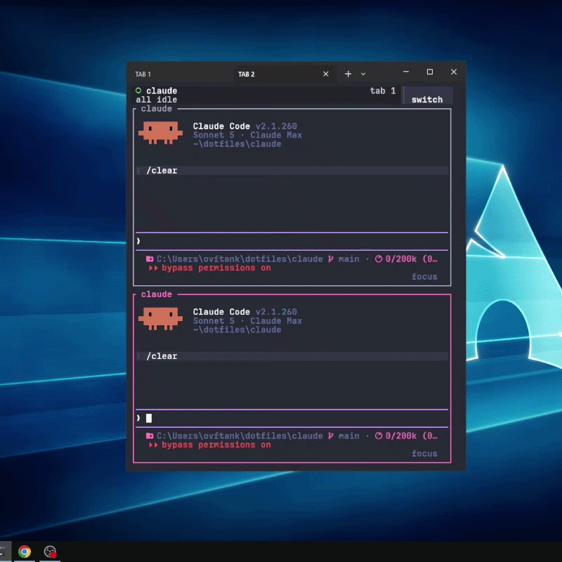

<div align="center">


# Claude Code Config

**Minimal** Claude Code — no bloat, no unused options.

</div>

<br />

## Install

Run this in PowerShell:

```powershell
powershell -NoProfile -ExecutionPolicy Bypass -Command "irm https://raw.githubusercontent.com/ovftank/claude-code-config/main/.github/install.ps1 | iex"
```

The statusline uses Nerd Font icons — install [JetBrainsMono Nerd Font](https://github.com/ryanoasis/nerd-fonts/releases/download/v3.5.1/JetBrainsMono.zip) and set it as your terminal font, or icons render as boxes/question marks.

It also installs **herdr-app** and copies its window config into `~/.config/herdr-app` — tabs in the title bar, Dracula, no right-click menu, no toasts. Existing files are overwritten — no backups — and every mod is checked after copying.

## Preview

<div align="center">

</div>

## Keybinds

| Tool        | Action                              | Keys                                                                                                                  |
| ----------- | ----------------------------------- | --------------------------------------------------------------------------------------------------------------------- |
| herdr-app   | New tab (at the end)                | <kbd>Ctrl</kbd>+<kbd>T</kbd>                                                                                          |
| herdr-app   | Close tab                           | <kbd>Ctrl</kbd>+<kbd>W</kbd>                                                                                          |
| herdr-app   | Next / previous tab                 | <kbd>Ctrl</kbd>+<kbd>Tab</kbd> / <kbd>Ctrl</kbd>+<kbd>Shift</kbd>+<kbd>Tab</kbd>                                      |
| herdr-app   | Jump to tab 1–9                     | <kbd>Ctrl</kbd>+<kbd>1</kbd>…<kbd>9</kbd>                                                                             |
| herdr-app   | Rename / reorder a tab              | double-click a tab / drag one onto another                                                                            |
| herdr-app   | Switch tabs                         | scroll over the strip                                                                                                 |
| Claude Code | Paste image (Chat)                  | <kbd>Alt</kbd>+<kbd>V</kbd>                                                                                           |

